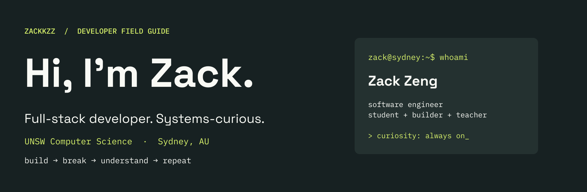

I'm **Zack Zeng**, a Computer Science student at **UNSW** who works across frontend, backend and infrastructure. I like building useful things—and understanding what happens beneath the abstractions.

🔧 IT Intern @ **Sungrow** · Software Engineer @ **[DevSoc / structs.sh](https://structs.sh)** & **Unify**  
🌱 Currently exploring **operating systems, database systems and Rust** through UNSW coursework.  
🧑‍🏫 DevSoc Training Lead and former UNSW tutor.

[LinkedIn](https://www.linkedin.com/in/zack-zeng-949081338/) · [My corner of the internet](https://www.zackkspace.com/) · [Explore my repositories](https://github.com/Zackkzz?tab=repositories)

## 🧰 Languages in my toolbox

`C` · `Rust` · `Python` · `Java` · `C#` · `TypeScript` · `JavaScript` · `Bash`

**Web & queries:** `HTML` · `CSS` · `SQL`

## 🧠 Where I connect the dots

| Area | What I work with |
| :--- | :--- |
| **Full-stack & mobile** | React, Next.js, React Native / Expo, Node.js, Express, FastAPI, Flask, REST APIs and WebSockets |
| **Systems & CS** | Linux, data structures & algorithms, MIPS assembly; operating systems and Rust through current coursework |
| **Compilers & data** | VC compiler development from scanner to code generator; PostgreSQL, SQLite, schema design and normalisation |
| **Shipping & quality** | Docker, Git, CI/CD, shell scripting, JUnit, Cypress, software testing and review |

<strong>🔍 Peek under the hood</strong>

- **CS foundations:** object-oriented programming, threads, virtual machines, binary and hexadecimal representation, and Unicode.
- **Architecture:** monolithic, service-oriented, event-driven, microservice and serverless architectures.
- **Developer workflow:** Make, CMake, Gradle, Markdown and YAML.
- **AI-assisted development:** Cursor, Claude, skills, harnesses and agentic workflows.

## 🚀 Things I've helped bring to life

| Project | The idea |
| :--- | :--- |
| **[structs.sh](https://github.com/devsoc-unsw/structs.sh)** | Make data structures and algorithms easier to understand. I work on backend and infrastructure. [Explore →](https://structs.sh) |
| **[Echo](https://github.com/Zackkzz/echo-unihack-2026)** | Connect people through anonymised shared experiences using semantic search. **Best Design @ UNIHACK 2026**, plus an honourable mention for Best Use of Elastic Technology. |
| **[Mealer](https://github.com/Zackkzz/icon_lyra_hackathon)** | Scan a receipt → track the pantry → generate recipes → plan the week. A full-stack mobile prototype. |
| **[PromptCoach](https://github.com/Zackkzz/csesoc_flagship_hackathon)** | Spot wasteful prompting habits and improve prompts in Claude Code and Codex. |
| **[AccessMap](https://github.com/Zackkzz/flexithon)** | Crowdsource accessibility-barrier reports for wheelchair users and people with mobility needs. |
| **[Meterwise](https://github.com/Zackkzz/Climate_Hackathon)** | Explore rental-home energy upgrades and model how bill savings could help repay them. |

## 🏆 A few milestones

- **UNIHACK 2026** — Best Design; honourable mention for Best Use of Elastic Technology.
- **CSESoc Flagship Hackathon 2026** — Finalist.
- **ICON × Lyra Hackathon 2026** — Finalist.

---

**Have something interesting to build? [Let's connect ↗](https://www.linkedin.com/in/zack-zeng-949081338/)**

Always learning. Usually building.
