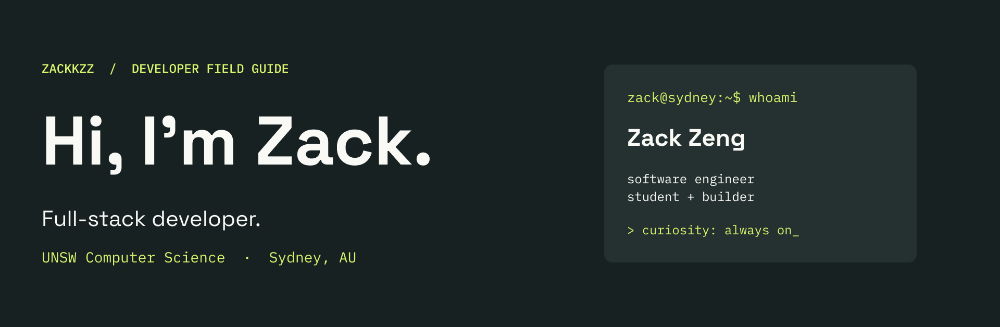

I'm **Zack Zeng**, a Computer Science student at **UNSW** who works across frontend, backend and infrastructure. I am building software with love and passion.

🔧 IT Intern @ **Sungrow** · Software Engineer @ **[DevSoc / structs.sh](https://structs.sh)** & **Unify**  
🌱 Currently exploring **Maching Learning Engineer** at UNSW.  

[LinkedIn](https://www.linkedin.com/in/zack-zeng-949081338/) · [Explore my repositories](https://github.com/Zackkzz?tab=repositories)

## 🧰 Skills

💻 **Languages:** C, C++, Rust, Python, Java, JavaScript/TypeScript, HTML/CSS, Shell (Bash)

🧩 **Frameworks / Libraries:** Next.js, Node.js, React.js, React Native, Expo, Flutter, Flask, Tailwind CSS

⚙️ **Backend:** Express.js, RESTful APIs, FastAPI, WebSockets

🗄️ **Databases:** PostgreSQL, SQLite, MongoDB, DBMS, relational and non-relational databases, ER diagrams, database design and normalization

🛠️ **Systems / Tools / Platforms:** Linux, Git, Docker, Gradle, CMake, Makefiles, Markdown (.md), YAML (.yaml)

🧪 **Testing:** JUnit, Cypress

🤖 **Agentic Programming:** Cursor, Codex, skills, harnesses, agentic workflows, optimization

🚢 **Software Development:** Software architectures (monolithic, service-oriented, event-driven / EDA, microservices, serverless), CI/CD, SDLC, software testing and review, client-facing software development, shell scripting

🧠 **Computer Science:** Data structures and algorithms, MIPS assembly, Unicode, threads, binary and hexadecimal systems, compilers (VC compiler from scanner to code generator), virtual machines, object-oriented programming

## 🚀 Things I've helped bring to life

| Project | The idea |
| :--- | :--- |
| **[structs.sh](https://github.com/devsoc-unsw/structs.sh)** | Make data structures and algorithms easier to understand. I work on backend and infrastructure. [Explore →](https://structs.sh) |
| **[Echo](https://github.com/Zackkzz/echo-unihack-2026)** | Connect people through anonymised shared experiences using semantic search. **Best Design @ UNIHACK 2026**, plus an honourable mention for Best Use of Elastic Technology. |
| **[Mealer](https://github.com/Zackkzz/icon_lyra_hackathon)** | Scan a receipt → track the pantry → generate recipes → plan the week. A full-stack mobile prototype. |
| **[PromptCoach](https://github.com/Zackkzz/csesoc_flagship_hackathon)** | Spot wasteful prompting habits and improve prompts in Claude Code and Codex. |
| **[AccessMap](https://github.com/Zackkzz/flexithon)** | Crowdsource accessibility-barrier reports for wheelchair users and people with mobility needs. |
| **[Meterwise](https://github.com/Zackkzz/Climate_Hackathon)** | Explore rental-home energy upgrades and model how bill savings could help repay them. |

## 🏆 A few milestones

- **UNIHACK 2026** — Best Design; honourable mention for Best Use of Elastic Technology.
- **CSESoc Flagship Hackathon 2026** — Finalist.
- **ICON × Lyra Hackathon 2026** — Finalist.

---

**Have something interesting to build? [Let's connect ↗](https://www.linkedin.com/in/zack-zeng-949081338/)**
